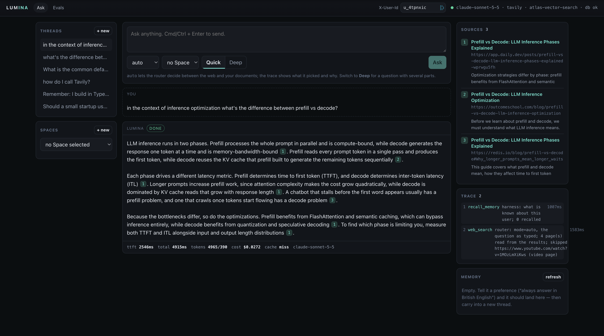
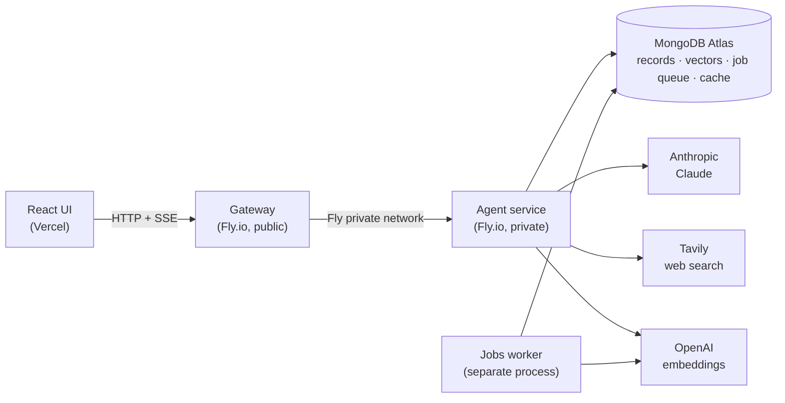

# LUMINA

**A Perplexity-style AI search engine.** Ask a question and get a streamed answer with
clickable citations, built from a live web search or from your own uploaded documents. Ask a
harder one in *deep* mode and it plans sub-questions, researches each in parallel, and merges
the results under one citation numbering.

**[Live demo](https://matteopilotto-lumina.vercel.app)** ·
**[Evaluation report](https://matteopilotto-lumina.vercel.app/evals)** ·
**[Design doc](DESIGN.md)**



---

## What it does

- **Quick search.** One web search returns both links and page text, so the sources appear
  before the first word of the answer, which typically starts streaming in about 1.5 seconds.
- **Deep search.** A planner splits the question into 3–6 sub-questions and streams the plan
  first. Each sub-question is researched concurrently, and the findings are merged into a single
  answer with deduplicated, renumbered citations.
- **Your documents.** Upload PDF, Markdown or plain-text files into a *Space*. A background worker parses,
  chunks, embeds and indexes them, and answers cite the exact page.
- **Memory.** "Remember that I prefer short answers" is saved through an explicit tool call. It
  is visible and deletable in the UI, and nothing is remembered that the user can't see.
- **Threads.** Follow-ups see the conversation, and the agent decides when to search again.
- **Observability.** Every answer writes a run log (tokens, cost, wall clock, why the loop
  stopped, ordered tool calls), and the UI shows a live trace of the agent's steps.

## Architecture



- **Gateway** is the only public backend, and it holds no API keys. It checks the user header,
  assigns a request id, validates bodies against the shared zod contract, rate-limits the
  routes that cost money, and relays the SSE stream frame by frame without buffering. If the
  agent dies mid-stream, it turns that into an `error` event rather than a silent stop.
- **Agent service** has no public IP. It is the only component with provider keys, so the
  limits that protect the bill live here and can't be bypassed: the tool-call cap, the
  wall-clock cap, and the per-user daily deep-search allowance.
- **Jobs worker** runs the slow ingestion pipeline in its own process, so a heavy PDF parse
  never stalls a streaming answer. MongoDB is its queue: atomic claims, retries, a sweeper for
  stale jobs, and a heartbeat that `/health` reports.
- **MongoDB Atlas** is the only durable state. It holds threads, memories, documents, chunks
  and run logs, plus the vector and full-text indexes, the job queue and a TTL search cache.
- **Hybrid retrieval** runs Atlas vector search and full-text search, then fuses the two
  rankings with Reciprocal Rank Fusion. A document is marked `indexed` only after a real
  query finds one of its chunks, because Atlas search indexes are eventually consistent.

## Results

Measured against the deployed app on 2026-10-04 by the course's benchmark: 79 answers,
concurrency 4, with targets declared in [`benchmark/sla.json`](benchmark/sla.json) before the
first run.

| Metric | Target | Measured |
|---|---|---|
| Time to first token, p95 (quick) | ≤ 2.5 s | **1.88 s** (p50 1.54 s) |
| Full answer, p95 (quick) | ≤ 12 s | **6.0 s** |
| Citation grounding (cited text found on the page) | ≥ 0.95 | **0.969** |
| Document recall@5 (30 gold questions) | ≥ 0.70 | **1.00** |
| Search cache hit rate | ≥ 50 % | **50 %** |
| Deep search: plan shown, p95 | ≤ 4 s | **3.45 s** |
| Deep search: full answer, p95 | ≤ 90 s | **21.7 s** |
| Deep vs. quick distinct sources | ≥ 2.0× | **2.5×** |
| Search latency during ingestion vs. idle | ≤ 1.3× | **0.83×** |
| Cost per answer: quick / deep | ≤ $0.05 / $0.35 | **$0.025 / $0.146** |
| Error rate | ≤ 1 % | **0 %** |
| Upload accepted (`202`), p95 | ≤ 300 ms | 329 ms ✗ |

15 of 16 targets pass. The upload acknowledgement is the one miss, by 29 ms.

## Engineering decisions

[`DESIGN.md`](DESIGN.md) covers each of these in full, with the measurements behind it and
what each one cost.

- **Quick search skips the model's research turn.** A fast search mode returns page text with
  the links, and the top pages become the sources directly. This took median time to first
  word from 6.6 s to 2.5 s. The cost was grounding: some pages are JavaScript-only, so the
  answer is checked against each page afterwards, and browser-only pages and sites are skipped
  for a week.
- **MongoDB plays four roles** (records, vectors, job queue, cache) instead of adding Pinecone,
  Redis and BullMQ. That means fewer services to deploy and secure, at the price of hand-written
  queue logic and lock-in to Atlas.
- **Two-tier search cache**: an in-process LRU over a Mongo TTL collection. The question is
  always searched first exactly as typed. Before that rule, the cache hit rate was 12.5 % on a
  half-repeat workload.
- **Small, explicit triggers instead of an extra model call.** Small talk, time-sensitive
  questions ("today", "latest") and questions that name a document or chapter each take a
  dedicated path. These are chosen by word patterns because an extra model turn would add
  latency to every question. The trade-off is that a phrasing not on the list falls through.
- **Every answer knows today's date.** A source may only be called current if it shows it is.
  This came from a deployed-app bug where "top news for today" was answered from 2024 pages.
- **Failures are loud.** A provider error ends the run with `502` (or an SSE `error`) instead of
  a plausible answer built on missing context, and a dead worker shows up on `/health` within
  15 seconds.

## Tech stack

TypeScript monorepo (npm workspaces) · Node 22 · Express · React 18 + Vite · zod ·
MongoDB Atlas (Vector Search, Atlas Search, GridFS) · Anthropic Claude (Sonnet for answers,
Haiku for research and planning) · OpenAI `text-embedding-3-small` · Tavily ·
pdf.js · Readability + jsdom · pino · Docker · Fly.io · Vercel

## Run it locally

You need Node ≥ 20.19, a MongoDB Atlas cluster (the free M0 tier works), and API keys for
Anthropic, OpenAI and Tavily.

```bash
npm install
cp .env.example .env        # fill in MONGODB_URI and the three API keys
npm run build               # builds the shared contract first (typecheck needs it)
npm run indexes             # creates the vector, text and TTL indexes on Atlas
npm run dev                 # UI :5173 · gateway :8787 · agent :8000
npm run worker              # in a second terminal: the ingestion worker
```

Open <http://localhost:5173>. To load the sample corpus into a Space, run
`./dev-upload.sh eval/gold/corpus/*`.

**Measure it:** `npm run bench` (latency, grounding, recall, cache, cost), `npm run quality`
(rules over the run logs), `npm run eval` (all gates in order).

**Deploy:** the agent and gateway run on Fly.io from one [`Dockerfile`](Dockerfile)
([`fly.agent.toml`](fly.agent.toml), [`fly.gateway.toml`](fly.gateway.toml)), and the UI runs
on Vercel. The agent's keys are set as `fly secrets`.

## Repository layout

```
backend/agent/      agent loop, tools, deep-search planner, RAG, memory, jobs worker   ← built by me
backend/gateway/    public edge: validation, rate limits, SSE relay                    ← built by me
DESIGN.md           architecture, state, failure modes and trade-offs                  ← written by me
Dockerfile, fly.*   deployment                                                         ← written by me
packages/contract/  typed API contract (zod schemas) shared by every service           ← provided
web/                React UI                                                           ← provided
benchmark/ eval/ quality/ scripts/   SLA benchmark, gold set, grader, index script     ← provided
PRD.md SPEC.md TECHNICAL.md AGENTS.md   the assignment's specification                 ← provided
```

## Credits

Built as Assignment 1 of the **FDE Agent Engineering Bootcamp** (cohort 2026-03) by
[Hamza Farooq](https://github.com/hamzafarooq). The course provided the React UI, the API
contract, the benchmark, the evaluation harness and gold corpus, and the specification;
the original brief is in [`docs/ASSIGNMENT.md`](docs/ASSIGNMENT.md). The two backend services,
their design, and the deployment are my work, and the full development history is in the
commit log.
